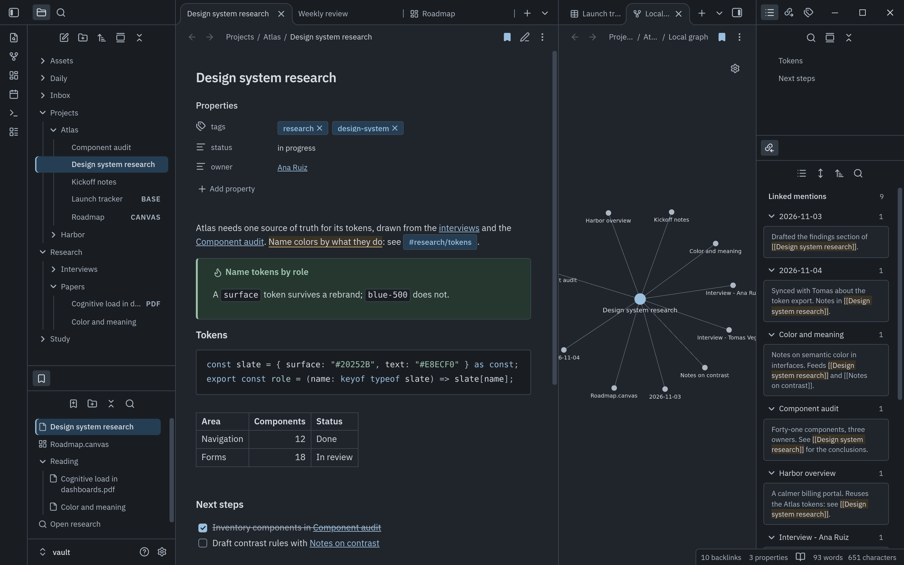
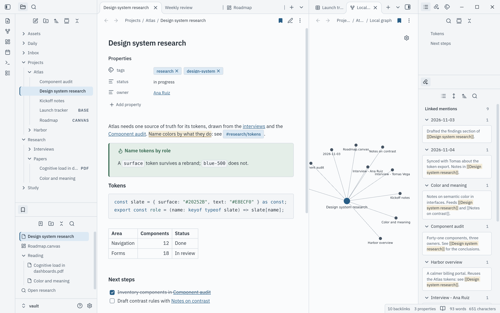

# Flatcap for Obsidian

  

  

  

Flatcap Slate (dark) above, Flatcap Daylight (light) below.

**Flatcap for Obsidian** brings the Flatcap visual system to your notes: matte graphite surfaces, one mineral-blue accent, IBM Plex for the interface and for reading, Cascadia for code.

It is a single `theme.css` with two independently tuned modes: **Slate** when Obsidian is dark and **Daylight** when it is light.

> The interface organizes. Content takes the foreground. Color informs.

## Install

### From the community directory (recommended)

1. Open **Settings → Appearance**.
2. Under **Themes**, click **Manage**.
3. Search for `FlatCap` and click **Install and use**.

The directory lists the theme as **FlatCap**, its original registered name. Updates arrive through Obsidian's theme updater.

### Manually

1. In your vault, create the folder `.obsidian/themes/FlatCap/` (the folder name must match the `name` in `manifest.json`).
2. Copy `theme.css` and `manifest.json` from the [latest release](https://github.com/cheycron/flatcap-obsidian/releases) (or from this repository) into it.
3. Reload Obsidian, open **Settings → Appearance → Themes** and pick **FlatCap**.

## Use it

The theme follows **Settings → Appearance → Base color scheme**: **Dark** uses Slate, **Light** uses Daylight, and **Adapt to system** follows your operating system.

Flatcap sets its own accent, so the *Accent color* picker has no effect while the theme is active. Fonts you choose under **Settings → Appearance** always win over the theme.

## Fonts

Obsidian themes cannot load fonts from the network, so Flatcap names them as local families. Install these on every device you use for the intended look:

- **[IBM Plex Sans](https://github.com/IBM/plex)** for the interface and reading.
- **[Cascadia Code](https://github.com/microsoft/cascadia-code)** (or Cascadia Mono) for code.

Without them the interface uses Segoe UI or your system font, and code uses `ui-monospace` or Consolas. Layout and colors are unaffected. See the [Flatcap typography guide](https://github.com/cheycron/flatcap-theme/blob/main/docs/typography.md).

## Accessibility

Text, links and syntax colors were measured in the running app (Obsidian 1.15.0, both modes) against the contracts of the [Flatcap core](https://github.com/cheycron/flatcap-theme): primary text at least 7:1, secondary and accent text at least 5:1, field boundaries and the focus ring at least 3:1. `python3 scripts/build.py --check` fails if `theme.css` is stale or a color does not come from `src/theme.json`. Increased contrast and forced colors are supported, and the current file, links and callouts never rely on color alone.

Limits that affect you:

- Only the link focus ring was confirmed in the running app; the tree-row and tab focus rules are in the stylesheet but a full keyboard walk-through is pending.
- Not covered: the graph's unresolved nodes (Obsidian dims them itself), screen readers, mobile layouts, Windows and macOS.

Measurements, motion and the rest are in the [reference](https://github.com/cheycron/flatcap-obsidian/blob/main/docs/mapping.md).

## Compatibility

- **Obsidian 1.13.4 or newer** (`minAppVersion`). Developed and checked on **1.15.0** (Linux). Versions between 1.12.7 and 1.13.4 have not been tested.
- Plugin-drawn UI that hard-codes its own colors is outside the theme's reach.

## Contributing

`theme.css` is generated from `src/theme.json` and `src/rules.css`; do not edit it by hand. Run `python3 scripts/build.py --check` before opening a pull request. Details are in [docs/mapping.md](https://github.com/cheycron/flatcap-obsidian/blob/main/docs/mapping.md).

## License

MIT © Cheycron Blaine. See [LICENSE](https://github.com/cheycron/flatcap-obsidian/blob/main/LICENSE).

## Support

If Flatcap makes your workspace calmer, you can support its development.

  

